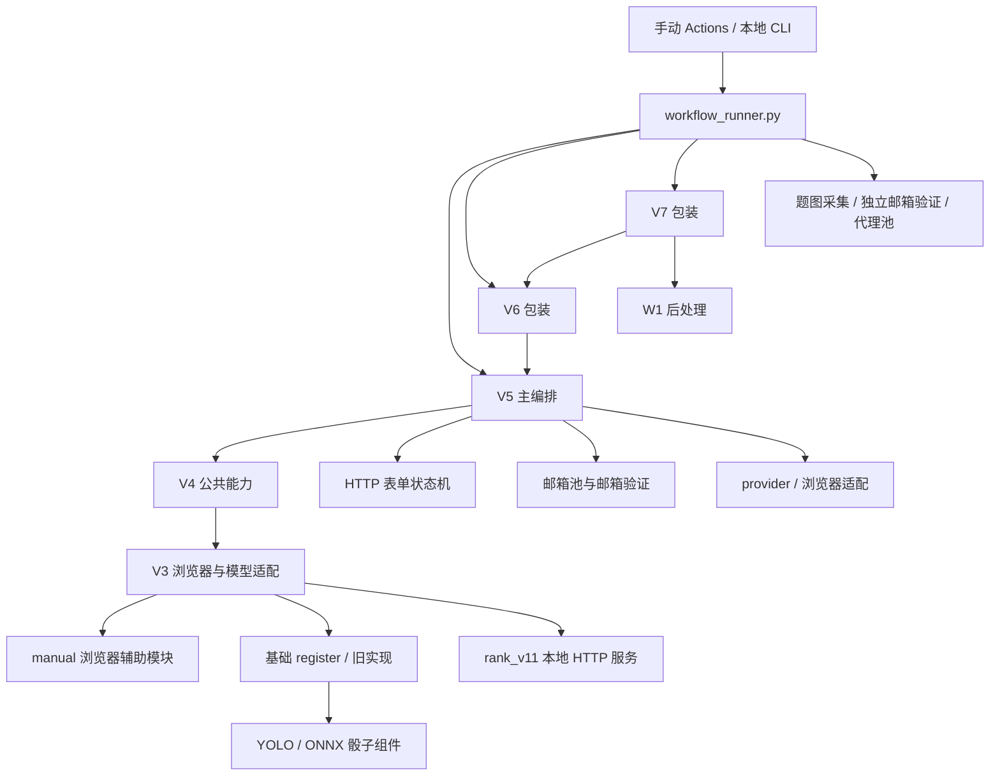

# 项目分析与后续开发地图

> Generated: 2026-10-16T20:02:05+08:00 | Mode: FULL
> 基线：main / a394cec51a333db93ca31e957137b86ff3dc0ab0。分析当前工作树；本轮不修改业务代码或 AGENTS.md。

## 项目定位

这是 Battle.net 注册、邮箱验证、题图采集和本地图像模型推理工具集。核心是 Python CLI 与手动 GitHub Actions，不是带前后端和数据库的 Web 应用。

理解当前代码最关键的一点：**V5 是主要编排实现，V6 在进程内替换 V5 的部分行为，V7 再包装 V6。** 版本号不是独立引擎边界。V3/V4 虽较旧，仍承担当前版本所复用的浏览器、模型服务和 HTTP 协议逻辑。

扫描基线包含 94 个 Git 跟踪文件，53 个 Python 文件、27,246 行 Python 源码，约 44 MB 跟踪文件（包括模型）。未把本地缓存、浏览器二进制、附件和运行记录计入源代码规模。

## Tech Stack

| 层 | 实际实现 |
|---|---|
| 语言与运行时 | Python；Actions 主要指定 Python 3.12；本机检查使用 3.12.10 |
| 执行方式 | 根目录 CLI 分发器、GitHub Actions matrix job、独立模型 HTTP 服务 |
| HTTP 与 HTML | curl_cffi 持久会话、requests、BeautifulSoup |
| 浏览器 | RuyiPage / Firefox / WebDriver BiDi；部分路径使用 CloakBrowser / Chromium / CDP |
| 图像模型 | rank_v11：PyTorch / torchvision；骰子组件：Ultralytics / ONNX Runtime |
| 数据保存 | 文本输入池、JSON 状态/结果、JSONL 事件、HTML 响应、图片、Actions artifacts |
| 数据库、前端、样式 | 当前未发现数据库/ORM、前端框架或独立 UI 工程 |

## Dependencies

依赖分散在六份 requirements 文件，当前没有锁文件。下表只记录仓库声明，不表示已经在本机安装或验证兼容。

| 文件 | 用途与关键声明 |
|---|---|
| `requirements.txt` | 旧 CloakBrowser 路径；cloakbrowser、websocket-client、requests，包含 YOLO requirements |
| `requirements-ruyipage-v4.txt` | RuyiPage >=1.2.46、curl_cffi >=0.15.0、beautifulsoup4 >=4.12.0、requests、websocket-client、NumPy、Pillow、OpenCV |
| `requirements-ruyipage-v5.txt` | 只包含 V4 requirements；也是 V6/V7 Actions 的基础依赖文件 |
| `rank_v11/requirements.txt` | torch >=2.2.0、torchvision >=0.17.0、NumPy、Pillow、OpenCV |
| `yolo/requirements.txt` | ultralytics >=8.4.90、onnxruntime >=1.18.0、OpenCV、Pillow、NumPy |
| `yolo/requirements-target-train.txt` | 目标数字分类器训练/导出：torch、onnx、onnxscript、Pillow、NumPy |

Actions 会根据选择的功能另外安装 torch/torchvision 或 cloakbrowser，因此单看根 requirements 无法代表某条业务流水线的完整环境。当前解释器未安装 pytest、curl_cffi、beautifulsoup4、NumPy、Pillow、OpenCV、torch、torchvision、ONNX Runtime 等关键包；本轮没有安装依赖或验证浏览器 runtime。

## Architecture Pattern

当前为多代脚本复用、适配器和文件状态组合的结构。主要复杂性来自动态加载、运行时全局替换，以及浏览器/HTTP 两种会话之间的交接。



### 动态加载约定

`workflow_runner.py:22` 的 `MODULE_NAMES` 登记了 24 个内部模块；`workflow_modules/` 实际有 25 个 Python 文件，额外的 `v7_email_pool.py` 当前没有接入白名单，静态搜索也未发现生产模块导入它。

`workflow_runner.py:50` 的 loader 从 `workflow_modules/` 读取代码，但刻意把 `__file__` 和编译路径设为根目录下的旧文件名（第 63 行）。各模块以 `Path(__file__).resolve().parent` 获取的因而是仓库根目录。这是兼容设计，不能直接按物理文件位置“修正”相关相对路径。

后续调用应走统一入口，或先导入 `workflow_runner` 安装 loader。直接执行 `workflow_modules/某脚本.py` 不等价。traceback 中显示的根目录虚拟文件名，需要映射回 `workflow_modules/` 查找源码。

### 版本职责

| 版本 | 当前作用 | 关键位置 |
|---|---|---|
| 基础 register | CloakBrowser 旧实现、公共常量/身份生成、骰子组件接入 | `workflow_modules/register.py:492`、`:1247` |
| V3 | RuyiPage 浏览器辅助、图像/结果监听、本地 rank 服务客户端 | `workflow_modules/register_ruyipage_v3.py:362`、`:1222` |
| V4 | 可恢复 HTTP 注册编排、浏览器启动/流量统计，复用 V3/manual | `workflow_modules/register_ruyipage_v4.py:41`、`:1016` |
| V5 | 主要配置、六种 provider、浏览器选择、HTTP 编排、诊断及结果输出 | `workflow_modules/register_ruyipage_v5.py:346`、`:2335` |
| V6 | 替换邮箱格式/验证器、默认输出、日志、失败分类，然后调用 V5 main | `workflow_modules/register_ruyipage_v6.py:153` |
| V7 | 默认关闭注册后邮箱验证，调用 V6，随后执行 WoW Trial 后处理 | `workflow_modules/register_ruyipage_v7.py:208` |

V6 会修改 V5 模块全局对象，V7 还会改环境变量和 V6 属性。当前命令通常各自独立启动进程；未来改成同一进程连续调多个版本时，需要先处理这些残留状态。

## Folder Structure

| 路径 | 作用 |
|---|---|
| `workflow_runner.py` | 10 个业务子命令、check、动态 loader |
| `workflow_modules/` | 25 个 Python 文件、17,797 行；注册、邮箱、代理、资源策略与采集逻辑 |
| `.github/workflows/` | 7 条手动业务流水线及汇总/清理逻辑 |
| `rank_v11/` | 13 个 Python 文件、2,961 行；三个 checkpoint、推理服务、CLI、Docker 示例 |
| `yolo/` | 12 个 Python 文件、1,901 行；两个 ONNX 模型、推理/数据准备/训练/导出工具 |
| `ruyipage_manual_register/` | 1,303 行；手动同浏览器流程，也被 V3/V4 当公共模块复用 |
| `ruyipage_browser_register/` | 3,051 行独立浏览器脚本；未发现主分发器调用关系 |
| 根目录文本文件 | 邮箱/账号/代理输入池和国家码表；不是统一配置格式 |
| `.codex/` | 本地助手配置；不是业务运行配置 |
| `.reasonix/`、`__pycache__/` | 本地工具记录/附件与 Python 缓存，不是核心模块 |

根 README 提到的 `v5_desktop_ui/`、`backup/legacy_registration_workflows_20260808/`、`backup/legacy_tools_20260808/` 在当前工作树中不存在。

## Code Style Conventions

- 主要使用 snake_case 函数/变量、PascalCase 类、UPPER_CASE 常量，CLI 多用 argparse。
- 大量使用 pathlib、类型标注、dataclass；新旧代码仍混用 `Optional`/`Dict` 与较新的联合类型写法。
- 模块多用 `from __future__ import annotations`；源码通常为 UTF-8，加载器兼容 UTF-8 BOM。
- 日志与异常信息中英混用；若干入口主动将 Windows stdout/stderr 调整为 UTF-8。
- 没有发现统一 formatter/linter/type checker 配置，不能把局部风格认作已执行的工程约束。
- `workflow_modules/README.md` 明确要求新增内部能力放入该目录，在 runner 注册，由 Actions 通过 runner 调用。

## Modularity Practices

适合按职责定位后续修改：

| 修改目标 | 优先阅读/修改的位置 | 影响范围 |
|---|---|---|
| CLI 分发、退出状态、路径兼容 | `workflow_runner.py` | 所有工作流 |
| HTTP 表单、状态恢复、响应分类 | `battle_protocol_flow_v4.py` | V4/V5/V6/V7 |
| 公共业务编排、provider 选择 | `register_ruyipage_v5.py` | V5/V6/V7 |
| V6 输入格式、验证状态与安全码处理 | `v6_email_pool.py`、`v6_email_verifier.py` | V6、V7 部分输入与独立邮箱验证 |
| W1 调度与浏览器后处理 | `register_ruyipage_v7.py`、`v7_w1_step.py` | V7 |
| 浏览器基础操作、图像监听 | V3、manual、`v5_cloak_adapter.py` | 多版本；存在复制实现 |
| 代理分配、网络计量、资源缓存 | `v5_proxy_pool.py`、`proxy_traffic_meter.py`、`v4_browser_resource_optimizer.py` | 多条工作流 |
| 模型协议/推理/规则 | `rank_v11/server.py`、`route_ranker/`、`yolo/solve.py`、`dice_solver/` | 各自题型；输入格式不同 |
| 并发、重试、汇总、回写输入池 | `.github/workflows/` 对应 yml | 远端执行和仓库文件 |

`register_ruyipage_v5.py` 已约 3,080 行，聚合配置、provider、流程、诊断和结果写入。新增能力宜优先落入对应 helper，避免继续扩张主函数。

## Data Architecture

没有数据库。主要实体是 identity、邮箱凭证、代理记录、持久化会话、业务结果和运行事件。

### 输入格式

- V5 邮箱凭证：`email|mailbox_password|refresh_token|client_id`，见 `v5_email_pool.py:37`。
- V6 邮箱凭证：`email----mailbox_password----client_id----refresh_token`；允许尾部字段省略，见 `v6_email_pool.py:60`。不要混淆 V5/V6 的字段顺序与分隔符。
- 邮箱池任务索引按有效记录从 1 开始，原物理行号保存为 `source_index`。Actions 在 prepare 阶段按任务分配。
- V7 实际使用 V6 邮箱解析器；单独的 `v7_email_pool.py` 当前不生效。

### 状态和结果

`battle_protocol_flow_v4.py:688` 的 `PersistentFlowState` 使用 schemaVersion=1，保存 identity、profile、cookies、form、response、arkose、result、history。更新时先写固定 `.tmp` 再 `os.replace()`；这是原子替换，不是多进程锁。

默认运行根目录分别为 `ruyipage_http_v11_register/runs`、`ruyipage_http_v5_register/runs`、`ruyipage_http_v6_register/runs`、`ruyipage_http_v7_register/runs`；新运行创建 `run_时间戳_微秒` 目录，恢复运行则沿用 resume 状态文件所在目录。

| 输出 | 语义 |
|---|---|
| `persistent_state.json` | 恢复状态，包含会话和 identity |
| `account_generated.json` | 生成的 identity；在注册成功前写入，不能单独作为成功证据 |
| `registration_result.json` | 注册服务端结果及邮箱验证子结果 |
| `summary.json` | 总体状态、诊断、耗时和相关配置摘要 |
| `diagnostic_trace.jsonl` | 关键阶段事件，定位停滞或失败位置 |
| `protocol_responses/` | HTTP 响应 HTML；响应元数据保存在状态/结果中 |
| 流量报告、截图与题图 | 网络/浏览器诊断材料 |
| V7 `w1_result.json` | W1 后处理结果 |
| V7 `registered_account.txt` / `w1_failed_account.txt` | 写在当前工作目录的账号输出/失败标记，不跟随自定义输出目录 |

V5/V6 的返回码 0 与 summary 顶层 `ok` 表示注册成功，邮箱验证失败仍可能返回 0；消费端需要另读 `emailVerification`。V7 在注册成功、W1 失败时保存账号并返回 1。Actions 还依赖 42、44、45 等退出码分配重试和保留输入行为，修改退出码需联查对应 yml。

V7 通过环境默认值关闭邮箱验证，但本地显式 `--verify-email yes` 仍可覆盖；当前 V7 Actions 显式传 `--verify-email no`。不要把默认行为当作不可覆盖的限制。

## Cross-Cutting Concerns

- HTTP 会话由 curl_cffi 持久化，并与浏览器辅助过程交接上下文；cookies 与原始响应会写入本地运行目录。
- 邮箱处理主要直连 Microsoft Graph，存在 O2 外部邮件读取 fallback。`o2_email_reader.py:179` 会向配置服务提交 client_id / refresh_token，这是需要了解的实际数据边界。
- 代理流量通过本地 forwarding proxy 计量，浏览器资源策略另行处理公共静态缓存和低价值请求。
- 异常通常写入 summary/diagnostic event，使用 `finally` 和 `contextlib.suppress` 关闭浏览器、会话与计量器。语法检查无法验证这些清理路径。
- 密钥主要从 CLI/环境/Actions secrets 获取，但独立 browser 脚本存在非空硬编码 API key；部分账号信息会直接进入日志和 artifacts。实际凭证有效性、仓库可见性未验证。

## Service Communication

| 组件 | 接口与约束 |
|---|---|
| rank_v11 | 标准库 ThreadingHTTPServer；`GET /health`、`POST /solve`；严格 2000×400、10 候选，answer_index 0–9 |
| rank 路径协议 | image 是服务端文件路径，不是图片上传；跨机器/容器需要共享挂载或调整协议 |
| rank 执行 | CPU/CUDA 自动选择，校验模型 hash，默认预热；单把锁使推理串行执行 |
| rank fast/accurate | fast 减少计算，但当前构造器仍加载三个 checkpoint，见 `route_v11_predict.py:64` |
| YOLO 骰子组件 | 至少 2400×400、12 候选，answer_index 0–11；ONNX 检测、目标数字识别与规则匹配 |
| YOLO 结果状态 | 无精确匹配也可能给出最近候选；必须区分 unique_match、multiple_matches、nearest_fallback |
| 外部交互 | 注册站点 HTTP/HTML、浏览器 BiDi/CDP、第三方 provider HTTP API、Graph/O2 邮件接口 |

两套模型输入布局和题型不同，不能仅凭都返回 answer_index 就互换。模型包中的历史评估指标不等于当前端到端业务成功率，本轮未复现模型效果。

只读完整性校验：rank manifest 引用的三个 checkpoint 均存在，SHA-256 全部匹配。旧 `rank_v11/PACKAGE_SHA256SUMS.txt` 的 24 项中有 7 项字节级匹配、17 项不匹配；其中 7 项仅为 CRLF/LF 差异，另外 10 项在常见换行/BOM 归一化后仍不匹配。因此旧整包清单不能代表当前源码包，不能据此推断模型损坏或文件遭到篡改。

## Test Coverage

**覆盖率：未测量。** 未发现跟踪的测试文件、pytest 配置、CI 测试门禁或覆盖率报告；不能用语法检查通过代替测试覆盖率。

本轮完成的离线检查：

| 检查 | 结果与范围 |
|---|---|
| `python workflow_runner.py check` | 24 个白名单内部模块编译通过；不执行导入或业务 |
| 所有跟踪 Python 源码内存 compile | 53/53 通过，包括 runner、未登记 helper、模型和独立浏览器脚本 |
| 分发器轻量检查 | 10 个命令、未知命令返回 2；loader 的虚拟路径与 spec origin 一致 |
| 入口错误转换隔离复现 | 对真实 proxy-pool main 注入内存空池，要求至少 1 条时，runner 返回 0 且无错误提示；未读输入文件、未探测网络 |
| V7 参数控制流隔离检查 | 提取实际 V7 parser/main、用无业务 stub 替代 V6；显式 W1 参数在第二层 parser 被拒。真实依赖和业务运行未验证 |
| 模型文件完整性 | rank 的三个 checkpoint 均与 manifest 中 SHA-256 一致；整包旧清单与当前源码存在上述差异 |
| pytest | 尝试 `python -m pytest -q -p no:cacheprovider`，禁用外部插件自动加载；因当前解释器没有 pytest，未执行测试 |

未运行浏览器、注册、邮箱访问、验证码求解、模型推理/训练、Docker 或任何远端 Actions。本轮验证没有业务成功率结论。

## GitHub Actions 与实际副作用

七条 yml 均为 `workflow_dispatch` 手动触发；没有 push / pull_request / schedule 触发器。它们是业务流水线。

| 工作流 | 作用与副作用 |
|---|---|
| `register-ruyipage-v5.yml` | V5 matrix；汇总 artifacts，清理已消费的 V5 邮箱池并 commit/push |
| `register-ruyipage-v6.yml` | V6 matrix；汇总结果，按结果清理 V6 邮箱池并 commit/push |
| `register-ruyipage-v7.yml` | V7 matrix；汇总注册/W1 结果，回写 wow1 输入池并 commit/push |
| `email-verify-ruyipage-v3.yml` | 并发直连邮箱验证；成功后清理账号源文件并 commit/push |
| `register-funcaptcha-snapshots.yml` | HTTP/浏览器多轮题图采集，上传采集结果；含单模块 compile 检查 |
| `capture-images.yml` | 旧采集兼容入口和产物汇总 |
| `Clear_All_Workflow.yml` | 用 GitHub API 删除工作流运行记录；默认选项范围较广 |

注册和邮箱验证流水线的 collect job 有仓库写操作，不宜当作无副作用的检查命令。当前本轮没有触发任何工作流。

## 已确认问题与建议顺序

以下是本轮观察，不是已实施的修复。

| 优先级 | 发现、证据与影响 | 建议 |
|---|---|---|
| P1 | `workflow_runner.py:107` 对字符串退出原因返回 0，`:130` 捕获 SystemExit 后复用该函数。`v5_proxy_pool.py:361`、`:370`、`:393` 恰好使用 SystemExit(错误字符串)。已用隔离空池复现静默成功 | 先修退出状态转换，并保留错误文本；给缺池、参数错误、预检失败增加离线回归 |
| P1 | `ruyipage_browser_register/battlenet_auto_register.py:56` 存在非空硬编码 API key；根目录多个邮箱/代理/账号池仍被 Git 跟踪，部分非空。V5 `:2947` 起直接打印账号密码，V6/V7 复用；`.gitignore` 未排除 V5/V6/V7 的生成运行目录 | 核对密钥用途/有效性，迁出源码与业务输入池；对日志和 artifacts 明确字段边界，不把 mask 当作产物脱敏 |
| P1（使用 W1 参数时） | V7 `:214` 解析 W1 参数，`:222` 调 V6；V6 `:171` 和 V5 `:2337` 再解析同一 argv，但没有接入 V7 parser | 将解析结果明确传递给后续层，避免多次解释 argv。当前 V7 Actions 没有传显式 W1 参数，不能认定该缺陷必然阻断现有默认流水线 |
| P2 | V5 `:2349` 支持 output-dir/resume；V7 `:235` 固定扫描默认目录，`:240` 按 mtime 选最新，可能遗漏自定义目录或误选其他运行 | 让调用方获得本次 run/result 明确路径，避免目录猜测 |
| P2 | V6/V7 修改邮箱文件帮助文字，但底层默认仍是 V5 的 Email_registing.txt；V7 EMAIL_POOL 环境名与 WOW1 映射不统一，W1_USER_DIR 未用作 parser 默认值 | 统一每个入口的 CLI、环境变量、默认值；Actions 显式传参补偿的行为也应有测试 |
| P2 | 无自动测试门禁、无依赖锁；部分依赖完全未约束，部分仅给下限 | 先补离线接口回归与 PR 检查，再固定实际验证过的运行环境 |
| P2（本地同目录并发） | 邮箱池更新固定临时名且无锁；V7 固定输出文件并按最新目录选运行 | 本地多进程使用独立工作目录；若要共享池需互斥/事务。现有 matrix runner 隔离，不能据此断言它必然发生同文件竞争 |
| P3 | README 指向不存在的 UI/归档目录；YOLO README 使用旧 Desktop 绝对路径；rank `route_v11_gate.py:197` 的评估 CLI 导入缺失的 route_v9_pair_train | 同步实际文档和可运行入口；缺失评估依赖不影响常规推理入口 |

另外，`v5_proxy_pool.py:231` 的预检使用 `verify=False`，其成功状态应解释为连通性探测，而不是远端身份或完整业务可用性保证。

## Entry Points 与后续工作起点

从仓库根目录运行以下无业务副作用命令可检查分发器和白名单语法：

```powershell
python workflow_runner.py --help
python workflow_runner.py check
```

业务子命令为 `register`、`register-v3`、`register-v4`、`register-v5`、`register-v6`、`register-v7`、`email-verify`、`funcaptcha-snapshots`、`capture-images`、`proxy-pool`。子命令会先导入相应模块，连 `--help` 也可能要求该模块依赖齐备。

建议后续顺序：入口退出码及离线回归 → V7 参数/结果路径契约 → 运行输入与输出边界 → 自动质量门禁和依赖固定 → 逐步拆分 V5 公共编排。具体改动先对照上面的职责表，改 V5 公共逻辑时同时核查 V6/V7 包装层与 Actions 汇总逻辑。

## Last Scanned

2026-10-16T20:02:05+08:00。后续变更请以本次 Git 基线为参照，重点复核入口白名单、版本包装、输出 schema 和各 yml 的消费逻辑。源代码行号仅对本次扫描基线有效。
